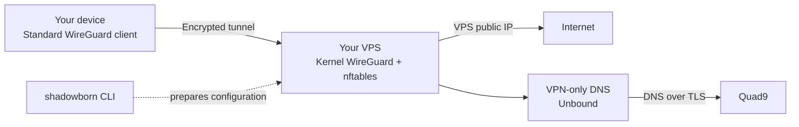

<div align="center">
  
  <h1>Shadowborn</h1>
  <p><strong>Your devices. Your server. Your Internet gateway.</strong></p>
  <p>WireGuard · Rust · nftables · Unbound · DNS over TLS</p>
  <p>
    <a href="#getting-started">Get started</a> ·
    <a href="docs/installation-server.md">Server setup</a> ·
    <a href="docs/client-enrollment.md">Connect a device</a> ·
    <a href="docs/no-logs-policy.md">Privacy policy</a> ·
    <a href="docs/validation.md">Test results</a>
  </p>
</div>

**Shadowborn is a self-hosted WireGuard gateway project for routing your devices'
Internet traffic through a Linux VPS you control.** You authorize each device
with its own keys, connect using a standard WireGuard client, and use the VPS as
your Internet exit point.

The Rust CLI prepares the gateway's configuration, manages per-device authorization, and produces protected server bundles and client profiles.
Packet forwarding runs through the Linux kernel, with nftables enforcing server
isolation and Unbound providing DNS through the tunnel.

> [!IMPORTANT]
> **Gateway preview.** A fresh server can be activated with an independent rollback
> timer. An administrator commits the deployment after testing DNS and egress
> from an enrolled peer. Linux clients can separately install a persistent
> firewall. The IPv4 gateway and strict client were exercised on Debian 13
> and Ubuntu 24.04 x86_64 VMs. Start with a disposable VM and a working console. See the
> [server guide](docs/installation-server.md) and [tested scope](docs/validation.md).

## How it works

A deployed gateway provides one encrypted connection between your device and your
VPS. The server forwards permitted Internet traffic through its public interface;
destinations receive connections from the VPS's public IP. DNS queries travel
inside WireGuard to the server's resolver, which forwards them to Quad9 using
authenticated DNS over TLS.



The configuration is provider-independent: you select the endpoint IP, WAN
interface, listening port, tunnel subnet and SSH administration range. The initial
evaluation targets are Debian and Ubuntu servers with systemd. No server OS
version is production-certified yet.

Client devices use standard WireGuard profiles. Linux clients can use `wg-quick`
and systemd without a custom client daemon. Other WireGuard applications are
best effort until their behavior has been tested.

## What Shadowborn provides

| Area | Available in this preview |
| --- | --- |
| **Server configuration** | Validated TOML and generated WireGuard, nftables, Unbound, forwarding and systemd configuration. |
| **Device authorization** | Individual public keys, unique tunnel IPv4 addresses, per-device preshared keys, and active/disabled/revoked states. |
| **Client profiles** | Templates for device-generated private keys, or an explicitly requested server-generated profile encrypted with age. |
| **Quick preparation and QR** | `setup` prepares a new server and first device; encrypted PNG QR and `.conf` exports contain the same per-device credentials. |
| **Server isolation** | Generated rules restrict peer sources, deny peer-to-peer and private-network forwarding, block cloud metadata access, and scope NAT to the selected WAN. |
| **DNS configuration** | A tunnel-bound resolver with pinned Quad9 DoT upstreams and plaintext upstream fallback disabled. |
| **Domain/IP filtering** | Reviewed domain/hosts lists, DNS allow exceptions, private names and IPv4 egress CIDRs; no query/hit history. |
| **Protected state** | Private files, exclusive locks, atomic writes, ownership checks and redacted diagnostics. |
| **Backup and restore** | age-encrypted configuration backups; offline restore preserves current disabled and revoked authorizations. |
| **Managed server** | Confirmed activation, timed rollback, boot recovery and live peer revocation. |
| **Strict Linux client** | Separate file-only helper, console trial, persistent provider dependencies and current firewall inspection. |
| **Packaging** | File-only installation, update and removal with ownership checks. Network activation is a separate operation. |

On a committed managed gateway, peer changes synchronize the protected state,
running WireGuard peer set and firewall. Alternate state directories are for
offline provisioning. Retire stale exported bundles after changing authorization.

The gateway supports IPv4 Internet egress. Its client profile includes both
default routes and the server blocks IPv6 forwarding. The optional strict
Linux client firewall covers both IP families during tunnel failure. A standard
import alone allows direct traffic after WG stops.

## Getting started

The [Mistborn coverage plan](docs/mistborn-parity.md) tracks the broader requested
platform: private management/MFA, DNS backends and optional self-hosted apps.
Only explicitly implemented features are available; the full platform is not
yet present. Native [filtering](docs/filtering.md) can be provisioned today.

For a fresh VM and a phone, start with the [server + QR walkthrough](docs/quickstart-qr.md).
`shadowborn setup --help` lists the endpoint, WAN and SSH allowlist inputs.
Preparation produces private server files and encrypted client imports; it does
not activate networking. A QR is a secret credential and is decrypted/viewed only
on the operator's trusted computer, never printed to the server terminal.

Build with Rust/Cargo and a C linker. The packaging scripts also require Python 3.
Run the following from the repository root:

```bash
cargo build --locked --release

./target/release/shadowborn version
./target/release/shadowborn doctor
./target/release/shadowborn --config config/server.example.toml validate
./target/release/shadowborn --config config/server.example.toml plan --json

./scripts/install-server.sh --dry-run
```

These commands build the CLI, inspect prerequisites and display the proposed
configuration. The example contains documentation IP addresses: replace the
endpoint, WAN interface and administrator CIDR before provisioning your server.

The server runtime uses `wireguard-tools`, nftables, Unbound, CA certificates and
systemd; encrypted exports and backups use age; QR exports use qrencode. The
[installation guide](docs/installation-server.md) covers dependencies, private
state initialization, console access, configuration review and managed activation.

### From a server plan to a connected device

1. **Prepare the VPS.** Select the endpoint and interfaces, review existing
   firewall and DNS configuration, and verify console access before activation.
2. **Create the device identity.** Prefer generating the private key on the
   device and sending only its public key to the server administrator.
3. **Authorize the device.** Initialize the gateway state, add the public key,
   and generate a server bundle and client template.
4. **Activate the fresh server.** Review `plan --host`, verify SSH and console
   access, then start the bounded activation trial.
5. **Import the client profile.** Transfer the profile securely, complete it on
   the device, and verify the tunnel, Internet egress and DNS behavior. Commit each applicable trial.

The [client enrollment guide](docs/client-enrollment.md) gives the exact key and
profile workflow, including the optional encrypted convenience export. Linux
`DNS =` integration depends on the client's resolver setup and must be checked
before using the profile on a working workstation.

## CLI reference

| Task | Command |
| --- | --- |
| Inspect prerequisites | `shadowborn doctor` |
| Prepare a fresh gateway and first device | `shadowborn setup --help` (see the [QR walkthrough](docs/quickstart-qr.md)) |
| Validate server configuration | `shadowborn validate` |
| Review a configuration plan | `shadowborn plan --json` |
| Initialize private gateway state | `sudo shadowborn init` |
| Authorize a device | `sudo shadowborn peer add --name laptop --public-key PUBLIC_KEY` |
| List authorized devices | `sudo shadowborn peer list` |
| Inspect a device with keys hidden | `sudo shadowborn peer show --name laptop --redacted` |
| Export a server review bundle | `sudo shadowborn render --output /root/shadowborn-review` |
| Export a client template | `sudo shadowborn client profile --name laptop --output /root/laptop.template` |
| Check domain/IP policy | `shadowborn --config config/server.example.toml policy check --input config/filtering.example.toml` |
| Import offline policy | `sudo shadowborn policy import --input /root/filtering.toml --confirm` |
| Revoke an authorized device | `sudo shadowborn peer revoke --name laptop --confirm` |
| Configure offline pinned DoH | `sudo shadowborn dns configure --stamp-file /root/upstream.stamp --confirm` |
| Export client firewall for VM review | `sudo shadowborn client lockdown render --output /root/client-review` |
| Inspect reported status | `shadowborn status` |

Replace `PUBLIC_KEY` with the device's actual public key. State operations require
an initialized gateway and root access; the system configuration defaults to
`/etc/shadowborn/config.toml`. Profiles and review bundles contain secrets and
must remain outside Git.

Additional commands cover disabling devices, PSK rotation, public-key export,
encrypted profile issuance, backup and offline restore. Use
`shadowborn COMMAND --help` for their required arguments and the
[recovery guide](docs/admin-recovery.md) for backup and restore boundaries.

Server activation uses `sudo shadowborn apply --console-verified --confirm`.
The strict Linux client has its own
[install, trial and commit procedure](docs/client-kill-switch.md). Current service,
interface and firewall status can be inspected locally. Test DNS and HTTPS from
the actual client before committing or reporting egress.


## Privacy and key custody

Shadowborn's stored state is limited to configuration, keys, assigned tunnel
addresses and authorization state. It does not include browsing history, DNS
query history, destination-flow history, handshake timelines or traffic counters.
There is no telemetry, analytics collector or background activity recorder.

The resolver disables query/reply logging and periodic statistics. Scoped
WireGuard and Shadowborn service-process journal streams were empty in the
Debian and Ubuntu VM tests through traffic, outages, revocation and reboot.
The [no-logs policy](docs/no-logs-policy.md) describes the checks and which
records remain under the control of the OS, network and provider.

Each device has a distinct keypair and PSK. Device-generated private keys stay on
the device in the preferred enrollment flow. The optional `peer issue` flow
requires explicit consent to generate a client key on the server and encrypts the
result to an operator-supplied age recipient. Backups contain necessary secrets
and authorization records, so their custody and retention matter too.

Optional `peer issue --qr-bundle PATH.png.age` also exports an encrypted QR of the
same profile. The client private key is absent from persistent authorization
state. A new device requires a separate peer and QR; sharing a QR shares access.

WireGuard protects the device-to-VPS connection. The local network and ISP can
still observe the VPN endpoint and traffic timing; the VPS provider can observe
egress metadata, and the upstream resolver receives DNS queries. Host OS and
provider logs remain outside this policy. HTTPS protects application content
independently. Account logins and browser identity remain
visible to the services you use. These boundaries are covered in the
[threat model](docs/threat-model.md).

## Validation and development

The recorded lab checks include a real kernel WireGuard tunnel, generated nftables
rules, IPv4 NAT and return traffic, selected host/metadata/source-spoofing blocks,
and traffic loss after explicit kernel peer removal. They use synthetic addresses
inside isolated namespaces.

The [validation matrix](docs/validation.md) records namespace and systemd VM
results, tested operating systems and the open hardware/provider release gates.
Benchmarks and their topology belong in the [performance guide](docs/performance.md).

```bash
# Build and test the Shadowborn packages.
cargo build --locked --release
cargo test --locked

# Check the complete workspace and packaging.
./scripts/validate.sh

# Run the isolated network lab when its prerequisites are available.
python3 tests/namespaces/shadowborn.py
```

The default workspace members are `shadowborn-core` for configuration and policy,
`shadowborn-platform` for protected storage and system-tool integration, and
`shadowborn-cli` for administration. Full workspace checks also cover retained
compatibility packages. See the [architecture](docs/architecture.md) for component
boundaries and the [compatibility guide](docs/legacy/README.md) when maintaining
an older installation.

## Documentation

| Guide | Contents |
| --- | --- |
| [Server setup](docs/installation-server.md) | Fresh VM preparation, dependencies, managed trial and commit. |
| [Server + QR walkthrough](docs/quickstart-qr.md) | Prepare a gateway and first device, decrypt locally and scan. |
| [Client enrollment](docs/client-enrollment.md) | Device keys, secure profile transfer and standard WireGuard import. |
| [DNS privacy](docs/dns-privacy.md) | Resolver configuration, encrypted upstreams and validation limits. |
| [Domain/IP filtering](docs/filtering.md) | Domain and hosts imports, exceptions, private names and IPv4 blocklists. |
| [Mistborn coverage](docs/mistborn-parity.md) | Complete requested feature inventory, status and integration gates. |
| [Client protection](docs/client-kill-switch.md) | Strict client trial, boot dependencies and console recovery. |
| [Administration and recovery](docs/admin-recovery.md) | Backups, revocation, recovery and removal. |
| [Security hardening](docs/security-hardening.md) | Host assumptions, permissions and service boundaries. |
| [Performance](docs/performance.md) | Measurement plan and current benchmark status. |
| [Polish introduction](docs/README.pl.md) | Krótkie wprowadzenie i odnośniki do instrukcji. |

## License

See the repository's [LICENSE](LICENSE) and
[package licensing notes](docs/licensing.md) for license terms and the outstanding
provenance reconciliation before distribution.
